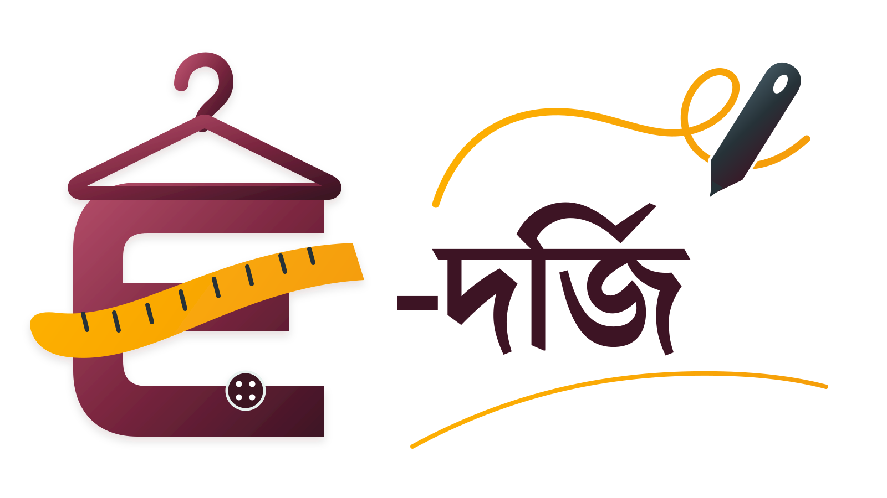

# E-দর্জি logo files

- `e-dorji-logo.svg` — transparent horizontal wordmark for the website and print.
- `e-dorji-icon.svg` — hanger and measuring-tape symbol for favicon and compact branding.

## Palette

| Use | HEX |
| --- | --- |
| Rose maroon | `#B64E6B` |
| Maroon | `#7A263F` |
| Deep maroon | `#3D1424` |
| Golden amber | `#FFB300` |
| Charcoal | `#263238` |
| White detail | `#FFFFFF` |

## Responsive navbar example

```html
<a class="brand" href="/" aria-label="E-দর্জি home">
  
</a>
```

```css
.brand img {
  display: block;
  width: clamp(104px, 10vw, 148px);
  height: auto;
}
```

Use the icon version as a favicon:

```html
<link rel="icon" type="image/svg+xml" href="/assets/e-dorji-icon.svg">
```
